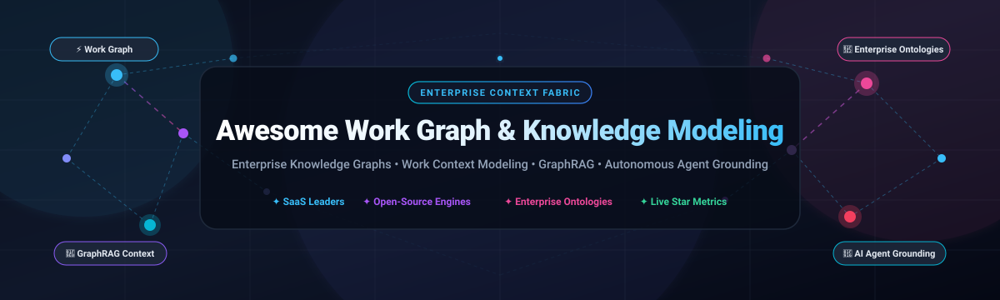
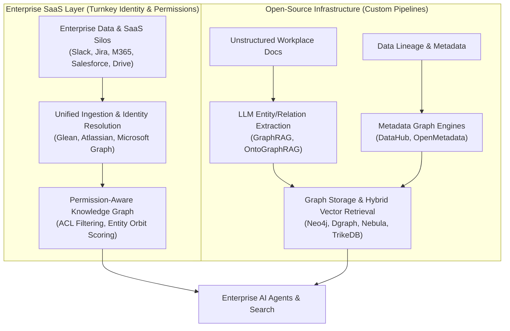

# 🌐 Awesome Work Graph & Knowledge Modeling 🧠

  

  
  
  
  
  

> 🚀 **A curated directory of enterprise work graphs, knowledge modeling platforms, GraphRAG engines, and workplace context backends for AI assistants and workforce intelligence.**

Enterprise Work Graphs and Knowledge Modeling architectures connect people, documents, communication channels, business entities, and activity telemetry into an interconnected, queryable graph. By exposing latent organizational context across siloed SaaS applications, these tools form the core operational context foundation for enterprise generative AI, AI agents, multi-hop GraphRAG retrieval, and organizational network analysis. 📊✨

---

## 📈 Sector Overview & Market Dynamics

The global enterprise knowledge graph and work context modeling market is estimated at **$2.9B – $3.5B in 2025–2026**, expanding rapidly at a ~21% to 31% CAGR fueled by the explosive adoption of GraphRAG, autonomous workplace AI agents, and zero-copy enterprise data fabric architectures. The market is **moderately fragmented**: mega-cap ecosystem platforms (Microsoft, Salesforce, Workday, Atlassian) capture dominant incumbent market share within their proprietary software suites, while specialized pure-play vendors (Palantir, Glean, Neo4j) compete fiercely for horizontal enterprise-wide context modeling, cross-application identity resolution, and neutral graph infrastructure. 💼🔍

---

## 📑 Table of Contents

- [📈 Sector Overview & Market Dynamics](#-sector-overview--market-dynamics)
- [🏢 SaaS & Hosted Enterprise Platforms](#-saas--hosted-enterprise-platforms)
- [🔓 Open-Source Knowledge Graphs & Engines](#-open-source-knowledge-graphs--engines)
- [⚖️ Comparative Architectural Tradeoffs](#️-comparative-architectural-tradeoffs)
- [⭐ Star History](#-star-history)
- [💖 Support & Community](#-support--community)
- [🤝 How to Contribute](#-how-to-contribute)
- [📜 License](#-license)

---

## 🏢 SaaS & Hosted Enterprise Platforms

The table below lists leading SaaS and enterprise-grade hosted platforms providing work graph modeling, enterprise search context, and organizational knowledge representation. Entries are sorted in descending order by company scale (market capitalization or latest enterprise valuation). 🏢💼

| Platform | Company Scale (Valuation / Market Cap) | Primary Focus & Work Graph Capabilities | Starting Pricing | Free Tier / Trial Limits |
| :--- | :--- | :--- | :--- | :--- |
| **[Microsoft Graph](https://learn.microsoft.com/en-us/graph/overview)** 🌐 | ~$3.1 Trillion | Unified API gateway linking Microsoft 365 services (Teams, Outlook, SharePoint, OneDrive), user identity, and external connectors into an enterprise work graph. | Included with Microsoft 365 plans (starting at **$6.00/user/month** for Microsoft 365 Business Basic). Data Connect billed at Azure consumption rates ($0.75 per 1,000 exported objects). | **Free developer tenant** via Microsoft 365 Developer Program (renewable 90-day sandbox with 25 E5 user licenses and 100K API requests/day). |
| **[Microsoft Viva Insights](https://learn.microsoft.com/en-us/viva/insights/)** 📊 | ~$3.1 Trillion | Workplace behavioral analytics platform modeling organizational collaboration, meeting habits, wellbeing metrics, and network connectivity patterns. | **$4.00/user/month** (standalone Viva Insights annual commitment, or bundled in Viva Suite at $12.00/user/month). | **Free forever plan** for personal insights within standard Microsoft 365 suites. Advanced leader/manager insights include a **30-day free trial** for up to 25 user licenses. |
| **[Salesforce Data 360](https://www.salesforce.com/data/)** ⚡ | ~$280 Billion | Real-time data engine providing Zero Copy data federation, customer 360 graphs, vector embeddings, and context grounding for Agentforce AI agents. | **$500 per month** (purchased in increments of 100,000 Flex Credits) or profile tiers starting at **$240/month** for foundational profile unification. | **$0 / Free Provisioning SKU** available for Enterprise and Unlimited Edition customers (includes 250,000 Data Cloud credits and 1 TB of unified data storage). |
| **[Palantir Foundry](https://www.palantir.com/platforms/foundry/)** 🔮 | ~$105 Billion | Enterprise operational ontology representing enterprise entities (nouns) and actions (verbs) with bidirectional writeback and kinetic AI agent execution. | **$100,000/month** baseline listing on AWS Marketplace (commitment-based Foundry Subscription Units [FSUs] for compute and ontology storage). | **30-day guided proof-of-concept trial** offered for qualified enterprise accounts; no public self-service free tier. |
| **[Workday Prism Analytics](https://www.workday.com/en-us/products/analytics-reporting/data-hub.html)** 📑 | ~$70 Billion | Unified enterprise data hub for HCM and Financials; ingests external operational data, models relational joins, and blends metrics with organizational hierarchies. | **$34.00/user/month** (typically structured as a 10%–20% uplift on Workday HCM subscriptions, scaling around $100–$500/employee/year). | **30-day sandbox trial** configured during enterprise sales evaluations; no public unassisted free tier. |
| **[Atlassian Teamwork Graph](https://developer.atlassian.com/platform/teamwork-graph/)** 🎯 | ~$48 Billion | Enterprise graph connecting Jira issues, Confluence pages, Loom videos, Goals, and Teams via unified GraphQL and Cypher endpoints for Rovo and Atlassian Intelligence. | Included with Atlassian Cloud subscriptions (Jira Cloud starts at **$7.75/user/month**; Atlassian Rovo agent context add-on starts at **$10.00/user/month**). | **Free forever tier** for Atlassian Cloud (up to 10 users for Jira and Confluence with native Teamwork Graph indexing). |
| **[Glean Knowledge Graph](https://docs.glean.com/security/knowledge-graph)** 🔎 | ~$4.6 Billion | Work AI and search knowledge graph connecting Content, People, and Activity across 100+ enterprise apps with strict permission-aware traversal and identity resolution. | **$45.00/user/month** base platform fee (often $45–$75/user/month with Enterprise Flex AI credits; annual minimums typically start at $50,000/year). | **30-day guided enterprise trial / POC** with up to 5 enterprise connectors and 50 pilot users upon sales verification. |
| **[Neo4j (AuraDB)](https://neo4j.com/cloud/platform/auradb/)** 🕸️ | ~$2.0 Billion | Fully managed native graph database and vector indexing engine; foundational GraphRAG infrastructure combining relationship traversal with semantic vector similarity. | **$0.09/hour** (~$65/month) for AuraDB Professional instances (1GB RAM, auto-scaling up to 384GB). | **Free forever instance** (AuraDB Free: 1 database, up to 200,000 nodes, 400,000 relationships, paused after 3 days of write inactivity). |
| **[Diffbot](https://www.diffbot.com/)** 🤖 | ~$100 Million | Autonomous web-scale knowledge graph and computer vision extraction platform; populates billions of entities and relationships queried via Diffbot Query Language (DQL). | **$299/month** (Startup plan including 250,000 credits, DQL query execution, and crawling features). | **Free forever plan** with 10,000 credits/month, 5 requests/minute rate limit, and full access to Knowledge Graph Search API. |
| **[OrgVue](https://www.orgvue.com/)** 👥 | ~$80 Million | Strategic workforce planning and organizational modeling engine; maps organizational structures, skill proficiencies, reporting relationships, and restructuring scenarios. | **£30,000/year** (~$38,000/year) baseline deployment license on UK G-Cloud / enterprise framework contracts. | **14-day guided proof-of-concept trial** with sample workforce dataset; no public self-service free tier. |

---

## 🔓 Open-Source Knowledge Graphs & Engines

The following open-source projects provide developer-led graph databases, metadata lineage catalogs, and GraphRAG knowledge extraction frameworks. Entries are sorted in descending order by GitHub stargazers count. 💻⭐

| Project | GitHub Stars | Primary Language / Stack | License | Description & Architectural Role |
| :--- | :--- | :--- | :--- | :--- |
| **[Microsoft GraphRAG](https://github.com/microsoft/graphrag)** 🧠 |  | Python | MIT | Modular pipeline utilizing LLMs to construct graph-based knowledge representations from raw workplace text, performing community detection and hierarchical summarization for complex multi-hop queries. |
| **[Dgraph](https://github.com/dgraph-io/dgraph)** ⚡ |  | Go | Apache-2.0 | High-performance distributed graph database with native GraphQL execution and GraphQL+- query syntax, designed for low-latency enterprise knowledge modeling and microservices. |
| **[Neo4j Community Edition](https://github.com/neo4j/neo4j)** 🌐 |  | Java | GPLv3 | The reference property graph engine supporting Cypher and ISO GQL; incorporates integrated vector search indexing for hybrid GraphRAG enterprise workflows. |
| **[OpenMetadata](https://github.com/open-metadata/OpenMetadata)** 📚 |  | Java / Python / TS | Apache-2.0 | Unified metadata graph modeling data pipelines, tables, schemas, teams, users, and end-to-end data lineage; provides an active governance fabric for modern data estates. |
| **[Cayley](https://github.com/CayleyGraph/cayley)** 🧩 |  | Go | Apache-2.0 | Lightweight, modular open-source graph database inspired by the knowledge graph behind Freebase and Google Knowledge Graph; supports Gizmo and SPARQL traversal. |
| **[DataHub](https://github.com/datahub-project/datahub)** 🎯 |  | Python / Java | Apache-2.0 | Extensible metadata platform originally created at LinkedIn; models enterprise entities, ownership, glossary terms, datasets, and cross-system relationships via a centralized graph schema. |
| **[Nebula Graph](https://github.com/vesoft-inc/nebula)** 🌌 |  | C++ | Apache-2.0 | Highly scalable distributed graph database engine engineered to handle complex knowledge graphs with billions of vertices and trillions of edges at sub-millisecond query latency. |
| **[R2R](https://github.com/SciPhi-AI/R2R)** 🔄 |  | Python / TypeScript | MIT | Production-ready framework for multi-modal Retrieval-Augmented Generation featuring automated knowledge graph extraction, community clustering, and agentic search pipelines. |
| **[Amundsen](https://github.com/amundsen-io/amundsen)** 🧭 |  | Python | Apache-2.0 | Data discovery and workplace metadata platform originally developed at Lyft; uses a Neo4j or Apache Atlas graph backend to index interaction patterns, owners, and data dependencies. |
| **[Memgraph](https://github.com/memgraph/memgraph)** 🚀 |  | C / C++ | BSL 1.1 / Apache-2.0 | In-memory graph database built for real-time Cypher querying, streaming graph analytics, and real-time knowledge graph event processing. |
| **[Apache HugeGraph](https://github.com/apache/incubator-hugegraph)** 🐘 |  | Java | Apache-2.0 | Distributed graph database supporting Apache TinkerPop and Gremlin query syntax, built for enterprise-scale graph modeling with pluggable backends (RocksDB, HBase, Cassandra). |
| **[ontograph-core](https://github.com/openshuyi/ontograph-core)** 📐 |  | TypeScript | MIT | Palantir-inspired open-source ontology modeling framework for TypeScript; provides programmatic entity and relation definitions, AST validation, and runtime graph constraints. |
| **[OntoGraphRAG](https://github.com/julka01/OntoGraphRAG)** 🧪 |  | Python | MIT | Ontology-guided GraphRAG framework that transforms unstructured enterprise documents into schema-consistent Neo4j knowledge graphs with hallucination-resistant Q&A. |
| **[TrikeDB](https://github.com/RyutoYoda/trikedb)** 🚲 |  | Python | MIT | Single-file, Git-friendly YAML knowledge graph database with SPARQL 1.1 support and native Model Context Protocol (MCP) server integration for autonomous AI agents. |

---

## ⚖️ Comparative Architectural Tradeoffs

| Evaluation Dimension | Enterprise SaaS (Glean, Atlassian, MS Graph) 🏢 | Self-Hosted Open-Source (Neo4j, DataHub, GraphRAG) 💻 |
| :--- | :--- | :--- |
| **Connector Ecosystem** 🔌 | 100+ turnkey, managed OAuth connectors with delta sync. | Custom ETL pipelines required via Airbyte, Meltano, or custom API scrapers. |
| **Identity & Permission Model** 🔐 | Real-time ACL synchronization matching enterprise directory (Okta, Entra ID). | Must be manually modeled, enforced in graph schemas, and filtered per query. |
| **Data Privacy & Governance** 🛡️ | SOC2 Type II, HIPAA, ISO27001 certified out-of-the-box. | Self-managed; full compliance control residing within your own VPC/cluster boundary. |
| **Cost Predictability** 💰 | High per-seat and annual contract commitment ($50K+ minimums). | Infrastructure-driven; compute and storage costs scale directly with actual usage. |
| **Extensibility & Agent Access** 🤖 | Governed APIs, persisted queries, and native Copilot/Rovo assistants. | Full programmatic control, native MCP endpoints, custom Cypher/SPARQL queries, and bespoke GraphRAG pipelines. |

---

## 🌟 Star History

---

## 💖 Support & Community

Thank you for visiting and supporting the **Awesome Work Graph & Knowledge Modeling** ecosystem! 🌟

If you found this repository insightful or valuable for your projects:
- ⭐ **Star this repository** on GitHub to help others discover it!
- 🍴 **Fork the repo** to contribute new tools or adapt it for your team.
- 📢 **Share it** with colleagues, data architects, and AI developers on social media and Discord communities!
- ☕ **Buy us a coffee / Sponsor**: Support ongoing maintenance and curation via the [GitHub Sponsor Dashboard](https://github.com/sponsors/ishandutta2007).

Your support keeps this curated catalog up-to-date and thriving! 🙏

---

## 🤝 How to Contribute

We welcome contributions from knowledge engineers, graph database architects, and workplace intelligence practitioners! 🛠️

1. **Fork the repository** to your personal GitHub account.
2. **Add or refine** tools in `README.md` maintaining table formatting, verified pricing data, and GitHub star badges.
3. Ensure open-source additions include valid GitHub links, active maintenance, and accurate star badge links.
4. **Submit a Pull Request** with a succinct description of changes and references for pricing or documentation.

---

## 📜 License

This project is licensed under the [MIT License](LICENSE). 📄
